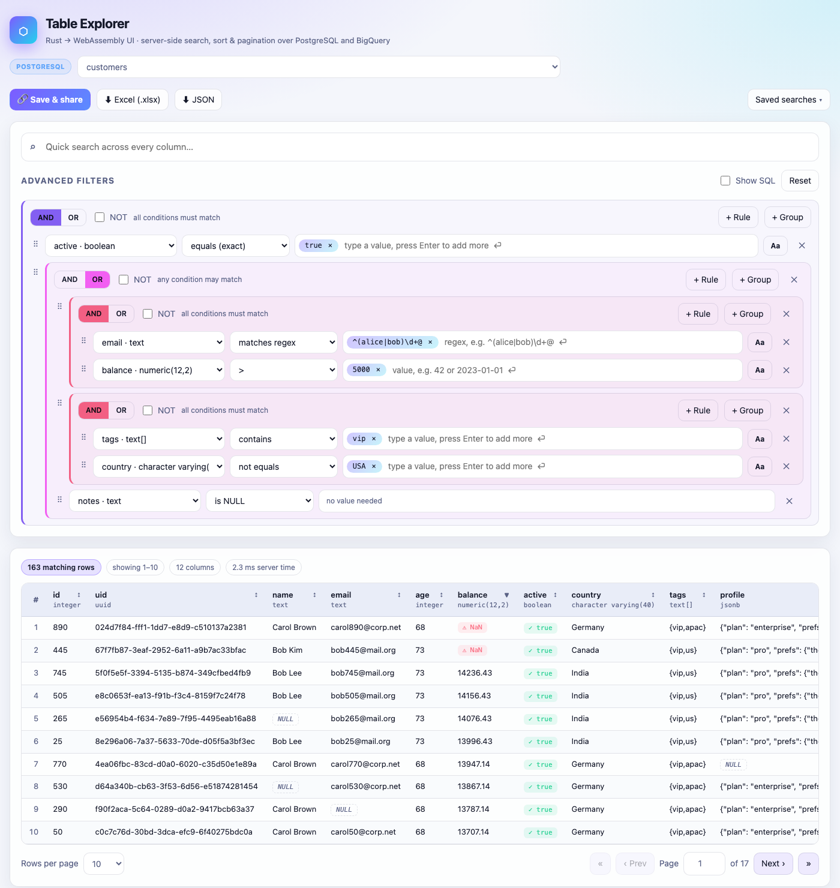
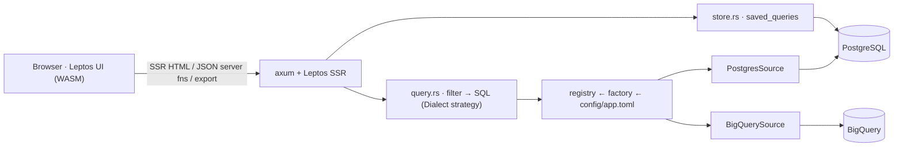

<div align="center">


# Table Explorer

**Server-side rendered search over PostgreSQL & Google BigQuery tables — built in Rust, running in the browser as WebAssembly.**

<p>
  
  
  
  
  
  
</p>

<p>
  <a href="#-quick-start"><b>Quick start</b></a> ·
  <a href="docs/USER_GUIDE.md"><b>User guide</b></a> ·
  <a href="docs/SETUP.md"><b>Setup</b></a> ·
  <a href="docs/END_TO_END_FLOW.md"><b>End-to-end flow</b></a> ·
  <a href="docs/DOCKER_DEPLOYMENT.md"><b>Docker</b></a> ·
  <a href="AI_AGENT_INSTRUCTIONS.md"><b>AI agent instructions</b></a>
</p>

<picture>
  <source media="(prefers-color-scheme: dark)" srcset="docs/assets/screenshot-dark.png">
  <source media="(prefers-color-scheme: light)" srcset="docs/assets/screenshot-light.png">
  
</picture>

</div>

---

## ✨ Features

<table>
  <tr>
    <td width="33%" valign="top">
      <h3>🔌 Pluggable sources</h3>
      PostgreSQL and BigQuery side by side, declared in <code>config/app.toml</code>.
      A <b>factory</b> builds each adapter; the UI groups tables by source with an engine badge.
      Unreachable sources stay listed with the reason.
    </td>
    <td width="33%" valign="top">
      <h3>⚡ Pure server-side</h3>
      Filtering, sorting, counting and paging run in the database —
      the browser only ever receives one page. The first HTML response already contains the table;
      WebAssembly hydrates it.
    </td>
    <td width="33%" valign="top">
      <h3>🧩 Nested search builder</h3>
      AND / OR / NOT groups at any depth, multi-value rules, drag-and-drop between groups,
      quick search across all columns, 15 operators including regex and <code>*</code>/<code>?</code> patterns.
    </td>
  </tr>
  <tr>
    <td valign="top">
      <h3>🔗 Save &amp; share</h3>
      Saved searches live in PostgreSQL and open via a <code>/s/&lt;uuid&gt;</code> link —
      anyone gets the same table and filters. The address bar is always a shareable link too.
    </td>
    <td valign="top">
      <h3>⬇ Excel &amp; JSON export</h3>
      Download every matching row (not just the page) as <code>.xlsx</code> — typed numbers,
      frozen header, autofilter, a sheet describing the search — or as typed JSON.
    </td>
    <td valign="top">
      <h3>🛡️ Mixed &amp; messy data</h3>
      Any column type (arrays, JSON, geometry, bytes…). <code>NULL</code>, empty and
      error-looking values are badged; bad input shows the database's error instead of crashing.
    </td>
  </tr>
</table>

## 🚀 Quick start

<details open>
<summary><b>Docker (app + seeded PostgreSQL)</b></summary>

```bash
git clone https://github.com/giridharmb/TableExplorer.git
cd TableExplorer
docker compose up --build
# → http://localhost:3000
```

More: [docs/DOCKER_DEPLOYMENT.md](docs/DOCKER_DEPLOYMENT.md)
</details>

<details>
<summary><b>Local development (Rust + project-local PostgreSQL)</b></summary>

```bash
rustup target add wasm32-unknown-unknown
cargo install cargo-leptos --version 0.3.11 --locked

initdb -D ./pgdata -U postgres --auth=trust
pg_ctl -D ./pgdata -o "-p 5433 -k /tmp" -l pgdata/log.txt start
createdb -h localhost -p 5433 -U postgres webui
psql -h localhost -p 5433 -U postgres -d webui -f db/seed.sql

cargo leptos watch                 # → http://127.0.0.1:3000
cargo test --features ssr --lib    # 13 unit tests
```

More: [docs/SETUP.md](docs/SETUP.md)
</details>

<details>
<summary><b>Add a PostgreSQL database or BigQuery dataset</b></summary>

Append a block to `config/app.toml` and restart — it appears as a new group in the table picker:

```toml
[[source]]
id = "bq_sales"
label = "Sales (BigQuery)"
kind = "bigquery"          # or "postgres" with url = "…" and schema = "…"
project = "my-gcp-project"
dataset = "sales"
location = "US"
tables = []                # [] = every table in the dataset
```

BigQuery uses Application Default Credentials (`GOOGLE_APPLICATION_CREDENTIALS`, gcloud, or the
GCP metadata server). Details: [docs/SETUP.md#bigquery-credentials](docs/SETUP.md#bigquery-credentials)
</details>

## 🏗️ Architecture



| Pattern | Where |
|---|---|
| **Factory** | `source::create` — maps a config `kind` to an adapter |
| **Strategy** | `Dialect` — `PgDialect`, `BqDialect` hold every SQL difference |
| **Adapter** | `DataSource` — `PostgresSource`, `BigQuerySource` (5 primitives each) |
| **Template method** | `query::{prepare, search, export}` — one search algorithm for all engines |
| **Registry** | sources built once at startup, looked up by id |

Full walkthrough with sequence diagrams: **[docs/END_TO_END_FLOW.md](docs/END_TO_END_FLOW.md)**

<details>
<summary><b>Repository layout</b></summary>

```
src/model.rs            shared types (filter tree, requests, pages, sources, saved queries)
src/app.rs              UI components (Leptos) + server functions
src/server/config.rs    config loading (${ENV} expansion, validation)
src/server/source.rs    Dialect + DataSource traits, factory, registry
src/server/query.rs     engine-independent filter compiler, search, export
src/server/postgres.rs  PostgreSQL adapter + dialect
src/server/bigquery.rs  BigQuery adapter (REST) + dialect
src/server/store.rs     saved/shared searches (saved_queries table)
src/server/export.rs    GET /export/{xlsx|json}
config/app.toml         storage DB + data sources
db/seed.sql             two 1000-row mock tables with NULLs and dirty values
style/main.css          design tokens, dark + light themes
Dockerfile, docker-compose.yml
docs/                   setup, user guide, end-to-end flow, Docker, README template
```
</details>

## 📚 Documentation

| Document | For |
|---|---|
| [docs/USER_GUIDE.md](docs/USER_GUIDE.md) | Building simple and deeply nested AND/OR searches, operators, examples |
| [docs/SETUP.md](docs/SETUP.md) | Local development, configuration, BigQuery credentials, troubleshooting |
| [docs/END_TO_END_FLOW.md](docs/END_TO_END_FLOW.md) | Startup, SSR, search, save/share and export flows (Mermaid diagrams) |
| [docs/DOCKER_DEPLOYMENT.md](docs/DOCKER_DEPLOYMENT.md) | Docker / Compose / Cloud Run deployment, production checklist |
| [AI_AGENT_INSTRUCTIONS.md](AI_AGENT_INSTRUCTIONS.md) | Complete spec for an AI agent to set up, rebuild, verify and extend the stack |
| [docs/templates/README_TEMPLATE.md](docs/templates/README_TEMPLATE.md) | The HTML README template this page is built from |

## ⚠️ Security

There is **no built-in authentication**: anyone who can reach the app can query every exposed
table and open every saved link. Deploy it behind SSO / an identity-aware proxy, expose only the
tables its users may see, and use read-only database users. See
[docs/DOCKER_DEPLOYMENT.md#5-production-checklist](docs/DOCKER_DEPLOYMENT.md#5-production-checklist).

<div align="center">
<sub>Built with Rust 🦀 · Leptos · axum · tokio-postgres · rust_xlsxwriter</sub>
</div>
