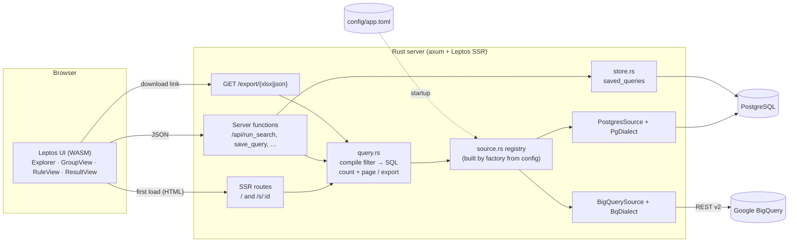
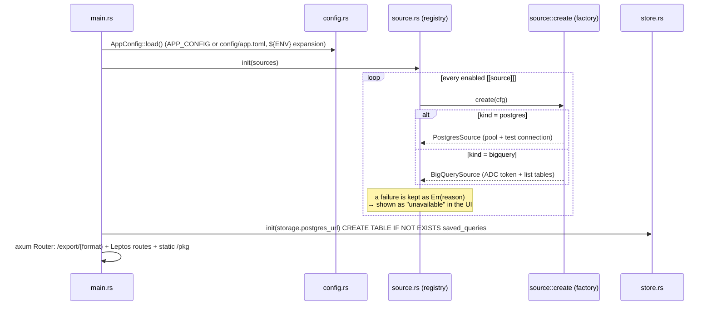
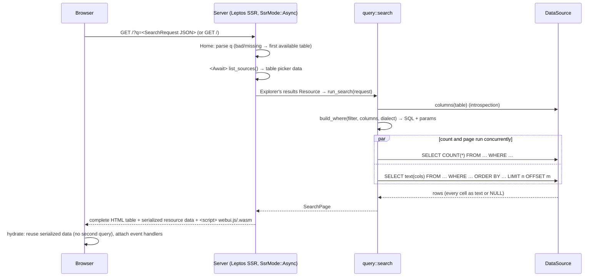
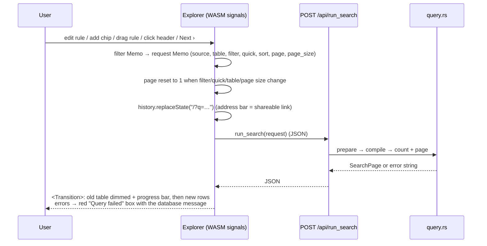
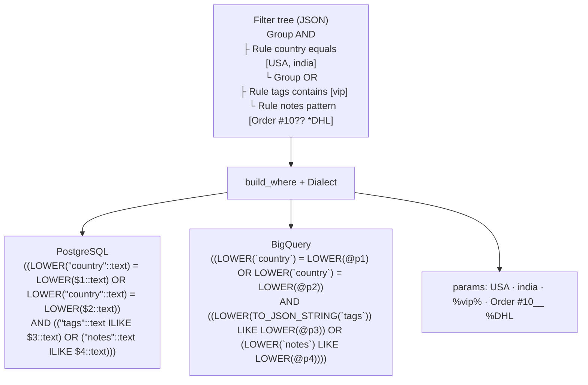
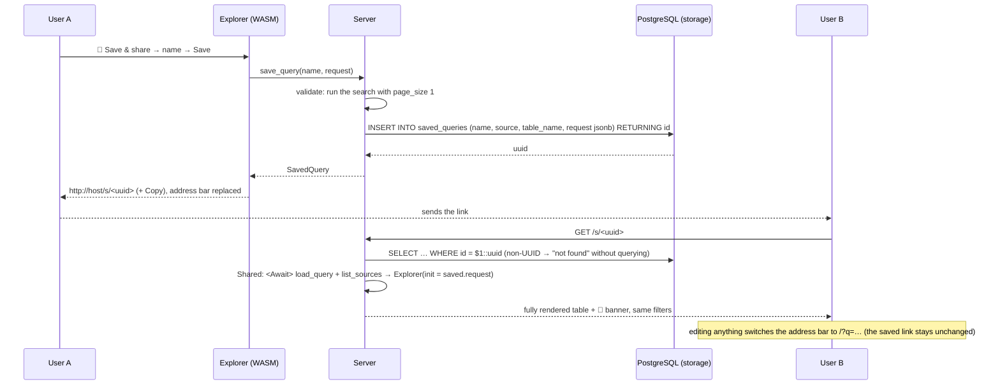
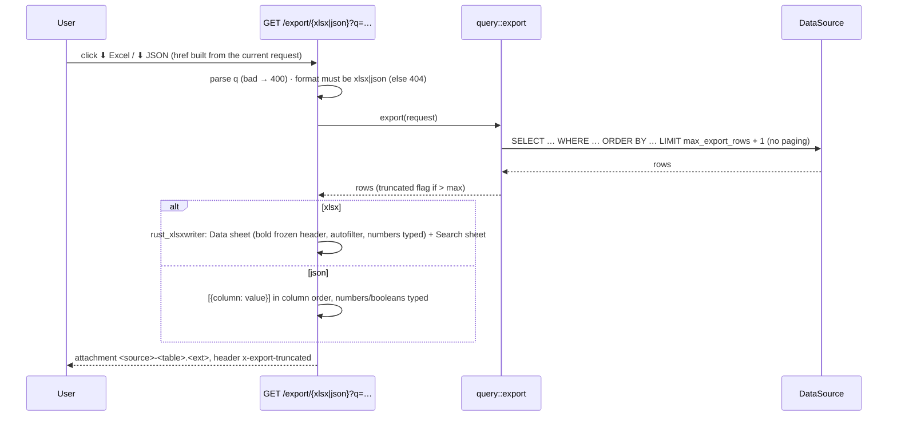
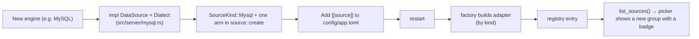

# End-to-end flow

How a request travels from the browser to PostgreSQL / BigQuery and back. Diagrams are Mermaid
(rendered by GitHub). File references are to `src/`.

## 1. Big picture

## 2. Startup

## 3. First page load (server-side rendering)

## 4. Searching, sorting, paging (after hydration)

### How a filter becomes SQL

Values are always bound parameters; column names come from introspection and are quoted by the
dialect. Full operator table: [AI_AGENT_INSTRUCTIONS.md §9.2](../AI_AGENT_INSTRUCTIONS.md#92-filter-compiler-srcserverqueryrs).

## 5. Save & share

## 6. Export

## 7. Plugging in another source

