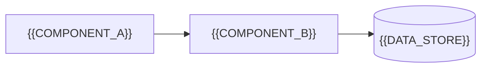

<!--
  GitHub README template (HTML + Markdown).
  GitHub renders a safe subset of HTML in README files: <div align>, <p align>, , <picture>,
  <table>/<tr>/<td width valign>, <details>/<summary>, <sub>/<sup>, <b>/<code>, <a>.
  It strips <style>, <script>, class/style attributes — so layout uses align/width/valign only.

  How to use:
    1. Copy this file to README.md.
    2. Replace every {{PLACEHOLDER}}.
    3. Put images in docs/assets/ (logo.svg, screenshot-light.png, screenshot-dark.png).
    4. Badges: https://shields.io — format https://img.shields.io/badge/<label>-<message>-<hexcolor>?logo=<simple-icons-name>
  Keep a blank line between HTML blocks and Markdown, otherwise GitHub renders the Markdown literally.
-->

<div align="center">


# {{PROJECT_NAME}}

**{{ONE_LINE_PITCH}}**

<p>
  
  
  
</p>

<p>
  <a href="#-quick-start"><b>Quick start</b></a> ·
  <a href="docs/USER_GUIDE.md"><b>User guide</b></a> ·
  <a href="docs/SETUP.md"><b>Setup</b></a> ·
  <a href="docs/DOCKER_DEPLOYMENT.md"><b>Docker</b></a>
</p>

<!-- Light/dark aware screenshot: GitHub picks the source matching the viewer's theme. -->
<picture>
  <source media="(prefers-color-scheme: dark)" srcset="docs/assets/screenshot-dark.png">
  <source media="(prefers-color-scheme: light)" srcset="docs/assets/screenshot-light.png">
  
</picture>

</div>

---

## ✨ Features

<!-- Feature cards: 3 columns × N rows. Keep each card to 2–3 short sentences. -->
<table>
  <tr>
    <td width="33%" valign="top">
      <h3>{{EMOJI}} {{FEATURE_1_TITLE}}</h3>
      {{FEATURE_1_TEXT}}
    </td>
    <td width="33%" valign="top">
      <h3>{{EMOJI}} {{FEATURE_2_TITLE}}</h3>
      {{FEATURE_2_TEXT}}
    </td>
    <td width="33%" valign="top">
      <h3>{{EMOJI}} {{FEATURE_3_TITLE}}</h3>
      {{FEATURE_3_TEXT}}
    </td>
  </tr>
</table>

## 🚀 Quick start

<details open>
<summary><b>{{PRIMARY_INSTALL_METHOD}}</b></summary>

```bash
{{PRIMARY_INSTALL_COMMANDS}}
```
</details>

<details>
<summary><b>{{SECONDARY_INSTALL_METHOD}}</b></summary>

```bash
{{SECONDARY_INSTALL_COMMANDS}}
```
</details>

## 🏗️ Architecture



## 📚 Documentation

| Document | For |
|---|---|
| [docs/USER_GUIDE.md](docs/USER_GUIDE.md) | {{WHO_IT_IS_FOR}} |
| [docs/SETUP.md](docs/SETUP.md) | {{WHO_IT_IS_FOR}} |

## ⚠️ Security

{{SECURITY_NOTES}}

<div align="center">
<sub>{{FOOTER}}</sub>
</div>
